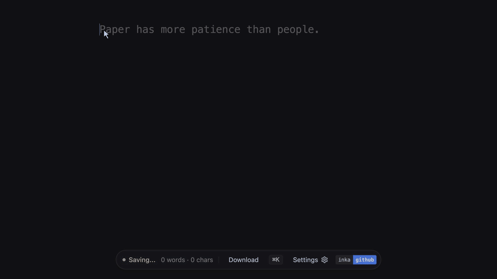
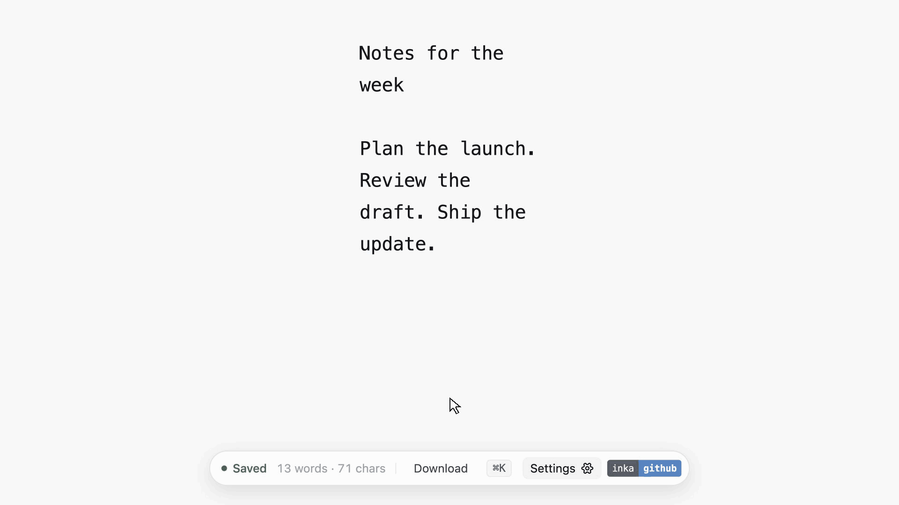

# Inka

```
╦ ╔╗╔ ╦╔═ ╔═╗
║ ║║║ ╠╩╗ ╠═╣
╩ ╝╚╝ ╩ ╩ ╩ ╩
```

> A quiet, persistent browser scratchpad with offline developer utilities.  
> Local-first by design: no accounts, no clouds, and your notes never leave your browser.

[](https://github.com/bobinx/inka/actions/workflows/deploy.yml)
[](LICENSE)
[](https://hits.sh/github.com/bobinx/inka/)

[**Open Inka →**](https://bobinx.github.io/inka/) · Drag [**Inka**](https://bobinx.github.io/inka/) to your bookmarks bar for one-click access.

---

## Demo

A clean scratchpad that silently remembers your notes across browser sessions, with an offline `⌘K` palette for in-place formatting, parsing, and calculations:

| Command Palette (`⌘K`) | Appearance & Controls |
| :---: | :---: |
|  |  |
| *In-place formatting, JSON, & calculations* | *Themes, font sizing, & margin controls* |

---

## Vision

Inka is is inspired by the following classic browser scratchpad trick I have used extensively over the past few years to pull up an editor to organise thoughts and explain stuff:

```html
data:text/html,<body contenteditable>

<!-- OR my personal favourite version -->
data:text/html,<body contenteditable style="font:2rem monospace;padding:2rem">
```
Type it in the address bar and you get an instant text editor. Just one downside, you lose all the notes if you accidentally close the tab.

Inka is built on the same idea. It provides a lightweight, instant, distraction-free writing canvas with added local persistence and a few nifty utilities. No signups, no external dependencies, and zero build steps.

---

## Features

- **Local Storage**: Notes save to browser `localStorage` as you type. Nothing leaves your machine.
- **Command Palette (`⌘K` / `Ctrl+K`)**: In-place text operations without leaving the editor:
  - **Case Conversion**: `camelCase`, `snake_case`, `kebab-case`, `Title Case`, `UPPERCASE`, `lowercase`
  - **Base Conversion**: Decimal ⇄ Hexadecimal, Decimal ⇄ Binary, URL Encode/Decode, Base64 Encode/Decode
  - **Line Operations**: Alphabetical sort, reverse lines, strip blank lines, remove duplicates
  - **Math Evaluation**: In-place arithmetic calculation (e.g., `(45 * 12) / 3` appends `= 180`)
  - **Generators**: Insert UUID v4, ISO timestamp, UTC date, Unix epoch
- **Plain Text Export (`⌘S` / `Ctrl+S`)**: Download notes anytime as `.txt`.
- **Appearance Controls**: Light, Dark, and Midnight themes with font size and side margin sliders.
- **Single-File Architecture**: Self-contained in a single ~40KB `index.html` file.

---

## Run Locally

Open `index.html` directly in any browser. No build tools, dependencies, or web server needed:

```bash
git clone https://github.com/bobinx/inka.git
open inka/index.html
```

---

## Privacy

- **Notes**: Stored strictly in local browser storage (`inka_notes`). No content or keystrokes ever touch a server.
- **Analytics**: The hosted version on GitHub Pages (`bobinx.github.io/inka`) loads cookie-less [Cloudflare Web Analytics](https://www.cloudflare.com/web-analytics/) solely for aggregate visit counts.
- **Offline / Local**: When run locally or offline, analytics are blocked via a hostname guard and make zero network requests.

---

## Contributing

Contributions and bug reports are welcome. Please open an issue to discuss proposed changes before submitting a pull request. Inka must remain a zero-dependency, self-contained, privacy first single HTML file.

---

## License

[MIT](LICENSE)
